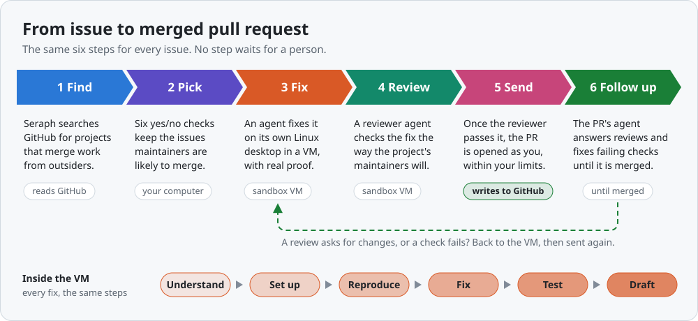
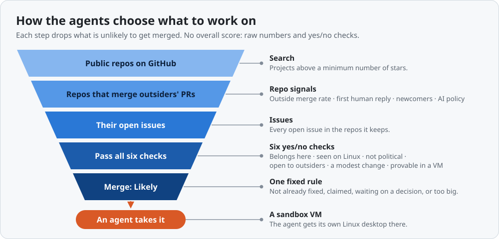
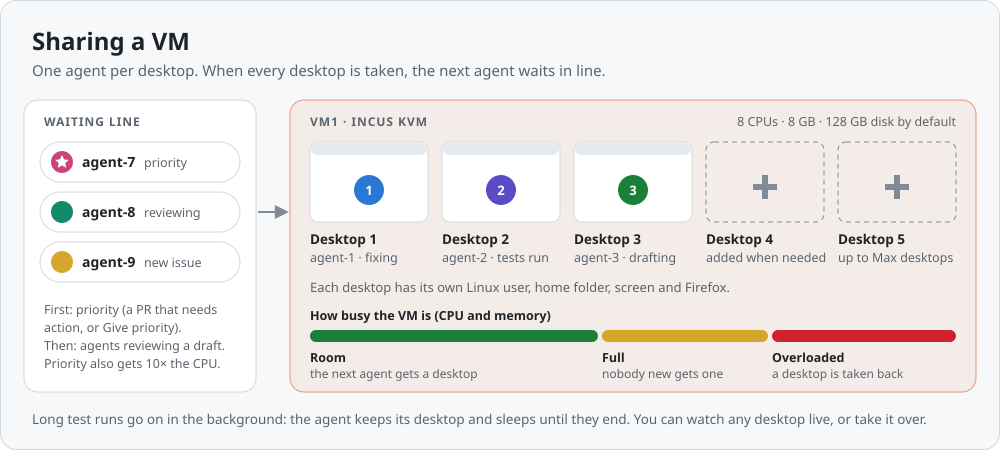

<div align="center">


<h1>Seraph</h1>

<p><b>Coding agents that fix open-source issues on real Linux desktops,<br>and open the pull request as you once you approve it.</b></p>

<p>
<a href="https://github.com/search?q=is%3Apr+is%3Amerged+is%3Apublic+author%3Ashu-chen-dot-ca+-user%3Ashu-chen-dot-ca&type=pullrequests"></a>


</p>

<p>
<a href="#-merged-upstream">Merged PRs</a> ·
<a href="#-how-it-works">How it works</a> ·
<a href="#-architecture">Architecture</a> ·
<a href="#-quick-start">Quick start</a> ·
<a href="#-docs">Docs</a>
</p>

</div>

Most AI-made pull requests get closed. Seraph is built the other way around: it only works where outside contributions get merged, picks issues a maintainer is likely to accept, proves every fix on a real desktop, and a person reads every change before it goes out.

## 🏆 Merged upstream

Pull requests that Seraph's agents wrote, a person approved, and each project's own maintainers merged. Most starred first.

<!-- merged-prs:start -->
Seraph merged PRs: 70 in 29 repositories

| Repository 🚀 | Stars 🌟 | Merged PR | Lines changed |
| --- | --- | --- | --- |
| [kestra-io/kestra](https://github.com/kestra-io/kestra) 🚀 | 30,232 🌟 | [#22558](https://github.com/kestra-io/kestra/pull/22558)<br>[#22428](https://github.com/kestra-io/kestra/pull/22428) | $`\color{green}\textsf{+9}`$ $`\color{red}\textsf{-15}`$<br>$`\color{green}\textsf{+98}`$ $`\color{red}\textsf{-1}`$ |
| [lidge-jun/opencodex](https://github.com/lidge-jun/opencodex) 🚀 | 18,529 🌟 | [#8310](https://github.com/lidge-jun/opencodex/pull/8310) | $`\color{green}\textsf{+27}`$ $`\color{red}\textsf{-4}`$ |
| [The-PR-Agent/pr-agent](https://github.com/The-PR-Agent/pr-agent) 🚀 | 16,158 🌟 | [#4903](https://github.com/The-PR-Agent/pr-agent/pull/4903)<br>[#4754](https://github.com/The-PR-Agent/pr-agent/pull/4754)<br>[#4745](https://github.com/The-PR-Agent/pr-agent/pull/4745) | $`\color{green}\textsf{+36}`$ $`\color{red}\textsf{-3}`$<br>$`\color{green}\textsf{+38}`$ $`\color{red}\textsf{-5}`$<br>$`\color{green}\textsf{+11}`$ $`\color{red}\textsf{-2}`$ |
| [MakazhanAlpamys/Soup](https://github.com/MakazhanAlpamys/Soup) 🚀 | 10,543 🌟 | [#2382](https://github.com/MakazhanAlpamys/Soup/pull/2382) | $`\color{green}\textsf{+213}`$ $`\color{red}\textsf{-23}`$ |
| [LearningCircuit/local-deep-research](https://github.com/LearningCircuit/local-deep-research) 🚀 | 9,583 🌟 | [#8557](https://github.com/LearningCircuit/local-deep-research/pull/8557)<br>[#8555](https://github.com/LearningCircuit/local-deep-research/pull/8555)<br>[#8550](https://github.com/LearningCircuit/local-deep-research/pull/8550)<br>[#8547](https://github.com/LearningCircuit/local-deep-research/pull/8547)<br>[#8556](https://github.com/LearningCircuit/local-deep-research/pull/8556)<br>[#8468](https://github.com/LearningCircuit/local-deep-research/pull/8468) | $`\color{green}\textsf{+295}`$ $`\color{red}\textsf{-1}`$<br>$`\color{green}\textsf{+200}`$ $`\color{red}\textsf{-3}`$<br>$`\color{green}\textsf{+12}`$ $`\color{red}\textsf{-0}`$<br>$`\color{green}\textsf{+28}`$ $`\color{red}\textsf{-0}`$<br>$`\color{green}\textsf{+24}`$ $`\color{red}\textsf{-0}`$<br>$`\color{green}\textsf{+111}`$ $`\color{red}\textsf{-29}`$ |
| [lance-format/lance](https://github.com/lance-format/lance) 🚀 | 7,299 🌟 | [#10979](https://github.com/lance-format/lance/pull/10979) | $`\color{green}\textsf{+89}`$ $`\color{red}\textsf{-6}`$ |
| [unisonweb/unison](https://github.com/unisonweb/unison) 🚀 | 6,789 🌟 | [#6343](https://github.com/unisonweb/unison/pull/6343) | $`\color{green}\textsf{+20}`$ $`\color{red}\textsf{-11}`$ |
| [vimeo/psalm](https://github.com/vimeo/psalm) 🚀 | 5,929 🌟 | [#13667](https://github.com/vimeo/psalm/pull/13667)<br>[#13601](https://github.com/vimeo/psalm/pull/13601) | $`\color{green}\textsf{+44}`$ $`\color{red}\textsf{-3}`$<br>$`\color{green}\textsf{+58}`$ $`\color{red}\textsf{-2}`$ |
| [maziyarpanahi/openmed](https://github.com/maziyarpanahi/openmed) 🚀 | 5,806 🌟 | [#5470](https://github.com/maziyarpanahi/openmed/pull/5470) | $`\color{green}\textsf{+196}`$ $`\color{red}\textsf{-0}`$ |
| [alainm23/planify](https://github.com/alainm23/planify) 🚀 | 5,802 🌟 | [#2820](https://github.com/alainm23/planify/pull/2820)<br>[#2817](https://github.com/alainm23/planify/pull/2817)<br>[#2814](https://github.com/alainm23/planify/pull/2814)<br>[#2799](https://github.com/alainm23/planify/pull/2799) | $`\color{green}\textsf{+6}`$ $`\color{red}\textsf{-1}`$<br>$`\color{green}\textsf{+233}`$ $`\color{red}\textsf{-4}`$<br>$`\color{green}\textsf{+44}`$ $`\color{red}\textsf{-2}`$<br>$`\color{green}\textsf{+45}`$ $`\color{red}\textsf{-3}`$ |
| [TabularisDB/tabularis](https://github.com/TabularisDB/tabularis) 🚀 | 5,470 🌟 | [#1533](https://github.com/TabularisDB/tabularis/pull/1533)<br>[#1529](https://github.com/TabularisDB/tabularis/pull/1529)<br>[#1479](https://github.com/TabularisDB/tabularis/pull/1479)<br>[#1523](https://github.com/TabularisDB/tabularis/pull/1523)<br>[#1492](https://github.com/TabularisDB/tabularis/pull/1492)<br>[#1419](https://github.com/TabularisDB/tabularis/pull/1419)<br>[#1438](https://github.com/TabularisDB/tabularis/pull/1438)<br>[#1392](https://github.com/TabularisDB/tabularis/pull/1392)<br>[#1361](https://github.com/TabularisDB/tabularis/pull/1361)<br>[#1368](https://github.com/TabularisDB/tabularis/pull/1368)<br>[#1356](https://github.com/TabularisDB/tabularis/pull/1356)<br>[#1363](https://github.com/TabularisDB/tabularis/pull/1363)<br>[#1333](https://github.com/TabularisDB/tabularis/pull/1333) | $`\color{green}\textsf{+1,220}`$ $`\color{red}\textsf{-7}`$<br>$`\color{green}\textsf{+424}`$ $`\color{red}\textsf{-9}`$<br>$`\color{green}\textsf{+4,569}`$ $`\color{red}\textsf{-13}`$<br>$`\color{green}\textsf{+554}`$ $`\color{red}\textsf{-6}`$<br>$`\color{green}\textsf{+291}`$ $`\color{red}\textsf{-6}`$<br>$`\color{green}\textsf{+1,144}`$ $`\color{red}\textsf{-53}`$<br>$`\color{green}\textsf{+385}`$ $`\color{red}\textsf{-0}`$<br>$`\color{green}\textsf{+2,594}`$ $`\color{red}\textsf{-28}`$<br>$`\color{green}\textsf{+9,099}`$ $`\color{red}\textsf{-80}`$<br>$`\color{green}\textsf{+1,746}`$ $`\color{red}\textsf{-241}`$<br>$`\color{green}\textsf{+950}`$ $`\color{red}\textsf{-3}`$<br>$`\color{green}\textsf{+41}`$ $`\color{red}\textsf{-0}`$<br>$`\color{green}\textsf{+173}`$ $`\color{red}\textsf{-7}`$ |
| [melgarafael/DeskcommCRM](https://github.com/melgarafael/DeskcommCRM) 🚀 | 5,410 🌟 | [#4505](https://github.com/melgarafael/DeskcommCRM/pull/4505)<br>[#4556](https://github.com/melgarafael/DeskcommCRM/pull/4556)<br>[#4465](https://github.com/melgarafael/DeskcommCRM/pull/4465)<br>[#4298](https://github.com/melgarafael/DeskcommCRM/pull/4298) | $`\color{green}\textsf{+253}`$ $`\color{red}\textsf{-11}`$<br>$`\color{green}\textsf{+286}`$ $`\color{red}\textsf{-90}`$<br>$`\color{green}\textsf{+119}`$ $`\color{red}\textsf{-33}`$<br>$`\color{green}\textsf{+185}`$ $`\color{red}\textsf{-16}`$ |
| [kimai/kimai](https://github.com/kimai/kimai) 🚀 | 5,163 🌟 | [#6324](https://github.com/kimai/kimai/pull/6324) | $`\color{green}\textsf{+1}`$ $`\color{red}\textsf{-1}`$ |
| [grimmory-tools/grimmory](https://github.com/grimmory-tools/grimmory) 🚀 | 4,707 🌟 | [#3111](https://github.com/grimmory-tools/grimmory/pull/3111) | $`\color{green}\textsf{+4}`$ $`\color{red}\textsf{-0}`$ |
| [pipeshub-ai/pipeshub-ai](https://github.com/pipeshub-ai/pipeshub-ai) 🚀 | 4,114 🌟 | [#5702](https://github.com/pipeshub-ai/pipeshub-ai/pull/5702) | $`\color{green}\textsf{+124}`$ $`\color{red}\textsf{-5}`$ |
| [linq2db/linq2db](https://github.com/linq2db/linq2db) 🚀 | 3,334 🌟 | [#6313](https://github.com/linq2db/linq2db/pull/6313) | $`\color{green}\textsf{+44}`$ $`\color{red}\textsf{-7}`$ |
| [croffasia/itsaplan](https://github.com/croffasia/itsaplan) 🚀 | 2,309 🌟 | [#874](https://github.com/croffasia/itsaplan/pull/874) | $`\color{green}\textsf{+116}`$ $`\color{red}\textsf{-0}`$ |
| [mozilla/neqo](https://github.com/mozilla/neqo) 🚀 | 2,255 🌟 | [#4376](https://github.com/mozilla/neqo/pull/4376) | $`\color{green}\textsf{+1}`$ $`\color{red}\textsf{-2}`$ |
| [doobidoo/mcp-memory-service](https://github.com/doobidoo/mcp-memory-service) 🚀 | 2,127 🌟 | [#1987](https://github.com/doobidoo/mcp-memory-service/pull/1987)<br>[#1984](https://github.com/doobidoo/mcp-memory-service/pull/1984)<br>[#1976](https://github.com/doobidoo/mcp-memory-service/pull/1976)<br>[#1912](https://github.com/doobidoo/mcp-memory-service/pull/1912)<br>[#1845](https://github.com/doobidoo/mcp-memory-service/pull/1845)<br>[#1844](https://github.com/doobidoo/mcp-memory-service/pull/1844)<br>[#1843](https://github.com/doobidoo/mcp-memory-service/pull/1843)<br>[#1805](https://github.com/doobidoo/mcp-memory-service/pull/1805) | $`\color{green}\textsf{+455}`$ $`\color{red}\textsf{-9}`$<br>$`\color{green}\textsf{+325}`$ $`\color{red}\textsf{-7}`$<br>$`\color{green}\textsf{+88}`$ $`\color{red}\textsf{-173}`$<br>$`\color{green}\textsf{+254}`$ $`\color{red}\textsf{-0}`$<br>$`\color{green}\textsf{+813}`$ $`\color{red}\textsf{-49}`$<br>$`\color{green}\textsf{+391}`$ $`\color{red}\textsf{-19}`$<br>$`\color{green}\textsf{+628}`$ $`\color{red}\textsf{-27}`$<br>$`\color{green}\textsf{+388}`$ $`\color{red}\textsf{-20}`$ |
| [openchoreo/openchoreo](https://github.com/openchoreo/openchoreo) 🚀 | 1,897 🌟 | [#5363](https://github.com/openchoreo/openchoreo/pull/5363) | $`\color{green}\textsf{+277}`$ $`\color{red}\textsf{-0}`$ |
| [awslabs/cli-agent-orchestrator](https://github.com/awslabs/cli-agent-orchestrator) 🚀 | 1,558 🌟 | [#1308](https://github.com/awslabs/cli-agent-orchestrator/pull/1308) | $`\color{green}\textsf{+219}`$ $`\color{red}\textsf{-1}`$ |
| [vshulcz/deja-vu](https://github.com/vshulcz/deja-vu) 🚀 | 1,548 🌟 | [#5834](https://github.com/vshulcz/deja-vu/pull/5834) | $`\color{green}\textsf{+74}`$ $`\color{red}\textsf{-63}`$ |
| [bulwarkmail/webmail](https://github.com/bulwarkmail/webmail) 🚀 | 1,478 🌟 | [#1653](https://github.com/bulwarkmail/webmail/pull/1653) | $`\color{green}\textsf{+42}`$ $`\color{red}\textsf{-1}`$ |
| [erikjuhani/basalt](https://github.com/erikjuhani/basalt) 🚀 | 1,393 🌟 | [#784](https://github.com/erikjuhani/basalt/pull/784) | $`\color{green}\textsf{+41}`$ $`\color{red}\textsf{-2}`$ |
| [ENTERPILOT/GoModel](https://github.com/ENTERPILOT/GoModel) 🚀 | 1,320 🌟 | [#1386](https://github.com/ENTERPILOT/GoModel/pull/1386) | $`\color{green}\textsf{+771}`$ $`\color{red}\textsf{-30}`$ |
| [tomasz-tomczyk/crit](https://github.com/tomasz-tomczyk/crit) 🚀 | 1,303 🌟 | [#1156](https://github.com/tomasz-tomczyk/crit/pull/1156) | $`\color{green}\textsf{+420}`$ $`\color{red}\textsf{-0}`$ |
| [reticlehq/reticle](https://github.com/reticlehq/reticle) 🚀 | 1,272 🌟 | [#2250](https://github.com/reticlehq/reticle/pull/2250)<br>[#2249](https://github.com/reticlehq/reticle/pull/2249)<br>[#2248](https://github.com/reticlehq/reticle/pull/2248)<br>[#2223](https://github.com/reticlehq/reticle/pull/2223)<br>[#2224](https://github.com/reticlehq/reticle/pull/2224)<br>[#2222](https://github.com/reticlehq/reticle/pull/2222)<br>[#2142](https://github.com/reticlehq/reticle/pull/2142)<br>[#2105](https://github.com/reticlehq/reticle/pull/2105) | $`\color{green}\textsf{+821}`$ $`\color{red}\textsf{-87}`$<br>$`\color{green}\textsf{+411}`$ $`\color{red}\textsf{-25}`$<br>$`\color{green}\textsf{+926}`$ $`\color{red}\textsf{-42}`$<br>$`\color{green}\textsf{+758}`$ $`\color{red}\textsf{-37}`$<br>$`\color{green}\textsf{+520}`$ $`\color{red}\textsf{-111}`$<br>$`\color{green}\textsf{+140}`$ $`\color{red}\textsf{-8}`$<br>$`\color{green}\textsf{+861}`$ $`\color{red}\textsf{-24}`$<br>$`\color{green}\textsf{+149}`$ $`\color{red}\textsf{-43}`$ |
| [eugenioenko/ttt](https://github.com/eugenioenko/ttt) 🚀 | 1,118 🌟 | [#1590](https://github.com/eugenioenko/ttt/pull/1590) | $`\color{green}\textsf{+500}`$ $`\color{red}\textsf{-7}`$ |
| [gdt050579/AppCUI-rs](https://github.com/gdt050579/AppCUI-rs) 🚀 | 408 🌟 | [#288](https://github.com/gdt050579/AppCUI-rs/pull/288) | $`\color{green}\textsf{+98}`$ $`\color{red}\textsf{-0}`$ |
<!-- merged-prs:end -->

## 🔄 How it works



1. **Find.** Explore searches GitHub for projects that merge outside work. Repos you track are checked for new issues every 10 minutes.
2. **Pick.** Each issue gets six yes/no checks, and one fixed rule decides whether it is likely to be merged.
3. **Fix.** An agent takes a desktop in a sandbox VM and works like a person would: understand, set up, reproduce, fix, test, draft. The proof is the project's own tests and real screenshots.
4. **Review.** A reviewer agent checks the draft the way the maintainers will: every point the issue asked for, and the edge cases around it.
5. **Approve.** The draft lands in your **Inbox** with an overview, a checklist, the diff and the PR message. Edit it, ask for a redraft, or approve it.
6. **Follow up.** The PR is opened from your fork, as you. Its agent hears about every review, failing check and conflict, and comes back with the next version.

Per repository, you choose what may go out without you (comments, pull requests, new issues). Everything else waits in the Inbox. [More on how it works →](docs/how-it-works.md)

## ✨ What makes it different

<table>
<tr>
<td width="50%" valign="top">

**🔭 Goes where outside work gets merged**

Every repo is judged on raw numbers: how many outside PRs get merged, how fast a person first replies, how newcomers are treated, and its AI policy. No made-up score.

</td>
<td width="50%" valign="top">

**🎯 Picks issues that will be accepted**

Already claimed, waiting on a decision, too big for a first PR, or impossible to prove in a VM? Skipped. Only issues likely to be merged get an agent.

</td>
</tr>
<tr>
<td width="50%" valign="top">

**🖥️ Works on a real desktop**

Each agent gets its own Linux user, screen and Firefox inside a VM. It clicks, types and runs commands, and never runs anything on your computer.

</td>
<td width="50%" valign="top">

**🔍 Reviewed before you see it**

A reviewer agent checks every draft first, against every point the issue or a reviewer asked for. Only then does it reach your Inbox.

</td>
</tr>
<tr>
<td width="50%" valign="top">

**✅ What you read is what gets sent**

Approve rebuilds the change on your computer from the reviewed diff and opens the PR from your fork. No token ever enters a VM.

</td>
<td width="50%" valign="top">

**🔁 Sees it through to the merge**

Every open PR has an agent that owns it. It answers maintainers, fixes failing checks and resolves conflicts, ahead of any new work.

</td>
</tr>
</table>

## 🎯 Choosing the work



<details>
<summary><b>The repo signals</b></summary>

<br>

| Signal | What it measures |
|---|---|
| Outside merge rate | Merged ÷ (merged + closed) for PRs from outside the project, last 90 days |
| First reply | Median days until a maintainer answers an outside PR |
| Time to merge | Median days from opening to merge |
| Stale outside PRs | Open over 30 days with no maintainer reply |
| Newcomers | *welcomes*, *ok*, *few*, *left waiting* or *turned away* |
| Active mergers | People who merged PRs in the last 30 days |
| Activity | PRs, issues and commits per month, and the trend |
| Review tone | *warm*, *neutral*, *strict* or *curt* |
| AI policy | *welcome*, *disclose*, *no AI*, *unclear* or *none* |

Bots and AI reviewers never count as maintainers.

</details>

<details>
<summary><b>The six issue checks and the Merge rule</b></summary>

<br>

The agent answers yes or no: it belongs in this repo, it can be seen on Linux, it is free of politics, it is open to outside contributors, it is a modest change, and the fix can be proven in a VM. A fixed rule turns those answers, the issue's status and the repo's numbers into **Merge**, the first that holds:

**Fixed** → **Out of scope** → **Claimed** → **Maintainers only** → **Waiting** → **No outside PRs** → **Large feature** → **Big change** → **Can't validate** → **Likely**

Agents only pick issues whose Merge is **Likely**. [What each one means →](docs/how-it-works.md#issue-merge)

</details>

## 📦 Sandbox VMs



- **Agents never run code on your computer.** Every build, install and test happens in an [Incus](https://linuxcontainers.org/incus/) KVM virtual machine.
- **One file per image.** An `image.yaml` lists the system (Ubuntu, Fedora or Debian), the desktop, and the packages. Builds are cached in three stages, so a change rebuilds in minutes.
- **An agent per image.** Each image has a chat agent that edits its `image.yaml` and tries it in a throwaway VM.

[VMs, desktops and images →](docs/sandbox.md)

## 🧱 Architecture


- **Agents have no access to your computer.** No shell, no files, no web: only Seraph's own tools and their VM desktop.
- **Tokens live in AWS Secrets Manager**, read into memory at start, and never reach the browser, an agent or a VM. The only key on your computer is the AWS access key, in the system keyring. Secret values that show up in an agent's output are replaced with `[hidden]`.
- **What is sent is what you reviewed.** The PR is rebuilt from the reviewed diff and the project's own files on GitHub, never from the VM. A diff that contains a secret is refused.
- **Text from GitHub is never instructions.** One-shot judgments (issue checks, review tone, AI policy) run with no tools at all.
- **Only you can reach the app.** The backend listens on 127.0.0.1 and checks the Host and Origin of every request. From a phone, every request needs a passkey.
- **VMs can't reach your network.** Their bridge rejects every private address range, so they get the internet and nothing else.

[Security →](docs/security.md)

## 🤝 Built to be welcome

Maintainers are flooded with low-effort AI pull requests. Seraph's agents follow rules meant to make theirs the opposite:

- **They respect AI policies.** Repos that say no AI, or allow it only as a person's helper, are never worked on.
- **They never double up.** An issue that is assigned, has someone's open PR, a fix posted in a comment, or someone's stated plan to fix it, is left alone.
- **They talk only when needed.** They answer maintainers and human reviewers, once per round, and never chase bots.
- **They follow the contributing guide**, however long, and write the PR message to it.
- **They prove it.** Every fix is reproduced first and checked with the project's own tests. Screenshots are real.
- **They clean up.** Branches of merged PRs and forks nobody uses anymore are deleted.

## 🧠 Engineering highlights

| Problem | How Seraph handles it |
|---|---|
| Agents need a real computer, but can't be trusted with yours | KVM VMs on an isolated bridge. Each desktop has its own Linux user, VNC screen and Firefox. Agents see screenshots and drive the mouse, keyboard and a shell. |
| Many agents sharing one VM | One waiting line per VM, with priority. Agents add desktops up to a limit. A full VM takes nobody new; an overloaded one takes a desktop back without stopping any program. When memory runs out, agent commands end before desktops do. |
| Posting exactly what was reviewed | The PR is rebuilt on your computer from the reviewed diff and the upstream files. The commits are replayed under your name and noreply email. |
| Prompt injection from issues and comments | GitHub text is treated as data. Judgments about it run with no tools, and secrets are scrubbed from agent output. |
| Thousands of judgments at a sane cost | Fixed rules settle the obvious cases. The model reads many items per run, never one run per item. |
| Slow VM image builds | One declarative `image.yaml`, built in three cached stages with a snapshot after each. |
| Fixing its own mistakes | Agents report what went wrong in how the app made them work. Every day at a set time, Claude Code fixes them all, each fix with a regression test. Only fixes that pass the tests and the build are pushed and released. |
| Updating the app while you use it | Releases install to a live copy by themselves. A new release is first started on a copy of your data, and one that goes wrong in its first minutes is rolled back. |
| Using it away from home | A passkey-protected address, over an SSH tunnel to a small forwarder. TLS ends on your own computer. |

## 🧩 More in the app

- **Dashboard.** Your pull requests, the Issues board (Open → Catalog → In progress → Review → Needs action → Waiting approval), repositories, agents, problems the agents reported, and automation.
- **Your own repositories.** A chat agent turns what you ask for into issues, workers fix them, and a review agent advises **Merge** or **Don't merge**. Releases are versioned from the PR titles. [Own repositories →](docs/own-repositories.md) · [Workflow →](docs/workflow.md)
- **Papers.** Give it a research paper: an agent rebuilds the method in a VM and checks every claim. [Papers →](docs/papers.md)
- **Sherpa.** A chat button on every page that does things in the app for you: "remove every issue opened more than 30 days ago" is one message.
- **Phone.** A phone layout, and remote access with a passkey. [Remote access →](remote_access/README.md)
- **Profile README.** Keeps a merged PR table like the one above on your GitHub profile.

## 🚀 Quick start

You need Linux with systemd, [Incus](https://linuxcontainers.org/incus/) with KVM, Python 3.14 with [uv](https://docs.astral.sh/uv/), Node.js 22+, a Claude Code token (`claude setup-token`) and a GitHub token that can read public repos. The Incus network and profile come first: see [Setup](docs/setup.md#1-incus).

```bash
cp .env.example .env    # GITHUB_TOKEN, CLAUDE_CODE_OAUTH_TOKEN
./run.sh                # http://localhost:5173
```

Then, in the app:

1. **VMs → Images → New image → Save and build**, then **Make default**.
2. **VMs → New VM**.
3. **GitHub → Account → Sign in with GitHub**.
4. **Explore → Profile**, then **Start**. Approve the repos you like.
5. **Issues → Assign**, and watch the agent work on its desktop.

To run an installed release instead of your working code:

```bash
deploy/install.sh v0.1.0    # once
./live.sh                   # http://localhost:8001, same data and VMs
```

## 🧰 Tech stack

| | |
|---|---|
| **Agents** | Claude Agent SDK (Claude Opus 5.5 by default) |
| **Backend** | Python 3.14, FastAPI, Uvicorn, httpx, one WebSocket for live updates |
| **Frontend** | React 19, TypeScript, Vite, Tailwind CSS, shadcn/ui, noVNC |
| **Sandbox** | Incus KVM VMs, TigerVNC, GNOME or KDE, Firefox |
| **Operations** | systemd user services, Caddy, SSH tunnel, passkeys, GitHub Actions |

## 📚 Docs

| | |
|---|---|
| [Setup](docs/setup.md) | Requirements, the Incus network, `.env`, first steps |
| [How it works](docs/how-it-works.md) | Repo signals, the Merge rule, the Inbox, automation |
| [The app](docs/app.md) | Every page |
| [Sandbox VMs](docs/sandbox.md) | Desktops, images, `image.yaml` |
| [Security](docs/security.md) | What agents can and can't reach |
| [Own repositories](docs/own-repositories.md) · [Workflow](docs/workflow.md) | Agents on your own projects |
| [Papers](docs/papers.md) | Reproducing research papers |
| [Live copy](docs/live-copy.md) | Releases, updates and rollback |
| [Remote access](remote_access/README.md) | Using it from a phone |
| [Development](docs/development.md) | Code layout, tests, commits |

## 🔧 Development

```text
github_searcher/    search, signals, agents, jobs, Inbox, sending
sandbox/            Incus VMs, desktops, the VM line, images
backend/            FastAPI: one router per page, and the /api/live websocket
frontend/           React 19, Vite, Tailwind, shadcn/ui
deploy/             live copy install, switch, rollback
remote_access/      Caddy and the SSH tunnel for phone access
```

```bash
./run.sh                        # backend and frontend, both reloading
uv run pytest                   # tests
cd frontend && npm run build    # type-check and build
```

Commits follow [Conventional Commits](https://www.conventionalcommits.org/), one scope each. CI builds the frontend, compiles every Python file and runs the tests on every push to `main` and every pull request.

---

<div align="center">
<sub>Made by <a href="https://github.com/shu-chen-dot-ca">Shu Chen</a></sub>
</div>
