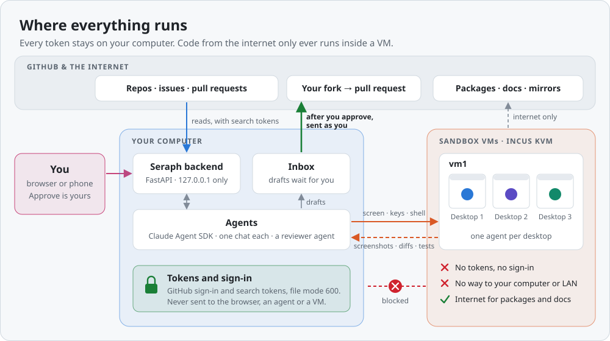

<div align="center">


<h1>Seraph</h1>

<p><b>Coding agents that fix open-source issues on their own Linux desktops,<br>and see each pull request through to the merge.</b></p>

<p>
<a href="https://github.com/search?q=is%3Apr+is%3Amerged+is%3Apublic+author%3Ashu-chen-dot-ca+-user%3Ashu-chen-dot-ca&type=pullrequests"></a>
</p>

</div>

Seraph contributes to open-source projects on its own. It finds projects that merge outside contributions, picks issues their maintainers are likely to accept, and hands each one to a coding agent with its own Linux desktop in a virtual machine. The agent reproduces the problem, fixes it, proves the fix with the project's own tests and opens the pull request. When maintainers review it, the same agent answers and pushes the next version until it is merged.

Its pull requests have been merged by projects including Kestra, Mozilla's neqo, AWS Labs' CLI Agent Orchestrator, Vimeo's Psalm and Unison.

## Merged pull requests

<!-- merged-prs:start -->
[Seraph](https://github.com/shu-chen-dot-ca/Seraph) has merged [156 PRs](https://github.com/search?q=is%3Apr+is%3Amerged+is%3Apublic+author%3Ashu-chen-dot-ca+-user%3Ashu-chen-dot-ca&type=pullrequests) across 44 repositories with a merge rate of 87% ([62 open](https://github.com/search?q=is%3Apr+is%3Aopen+is%3Apublic+author%3Ashu-chen-dot-ca+-user%3Ashu-chen-dot-ca&type=pullrequests), [23 closed](https://github.com/search?q=is%3Apr+is%3Aclosed+is%3Aunmerged+is%3Apublic+author%3Ashu-chen-dot-ca+-user%3Ashu-chen-dot-ca&type=pullrequests))

| Repository 🚀 | Stars 🌟 | Merged PR | Lines changed |
| --- | --- | --- | --- |
| [openclaw/openclaw](https://github.com/openclaw/openclaw) 🚀 | 395,300 🌟 | [#204881](https://github.com/openclaw/openclaw/pull/204881)<br>[#204900](https://github.com/openclaw/openclaw/pull/204900) | $`\color{green}\textsf{+59}`$ $`\color{red}\textsf{-22}`$<br>$`\color{green}\textsf{+52}`$ $`\color{red}\textsf{-2}`$ |
| [agentscope-ai/agentscope](https://github.com/agentscope-ai/agentscope) 🚀 | 36,771 🌟 | [#4102](https://github.com/agentscope-ai/agentscope/pull/4102) | $`\color{green}\textsf{+137}`$ $`\color{red}\textsf{-2}`$ |
| [kestra-io/kestra](https://github.com/kestra-io/kestra) 🚀 | 30,376 🌟 | [#22703](https://github.com/kestra-io/kestra/pull/22703)<br>[#22558](https://github.com/kestra-io/kestra/pull/22558)<br>[#22428](https://github.com/kestra-io/kestra/pull/22428) | $`\color{green}\textsf{+27}`$ $`\color{red}\textsf{-2}`$<br>$`\color{green}\textsf{+9}`$ $`\color{red}\textsf{-15}`$<br>$`\color{green}\textsf{+98}`$ $`\color{red}\textsf{-1}`$ |
| [xerj-org/xerj](https://github.com/xerj-org/xerj) 🚀 | 21,647 🌟 | [#3255](https://github.com/xerj-org/xerj/pull/3255)<br>[#3062](https://github.com/xerj-org/xerj/pull/3062) | $`\color{green}\textsf{+116}`$ $`\color{red}\textsf{-4}`$<br>$`\color{green}\textsf{+293}`$ $`\color{red}\textsf{-15}`$ |
| [lidge-jun/opencodex](https://github.com/lidge-jun/opencodex) 🚀 | 18,767 🌟 | [#9105](https://github.com/lidge-jun/opencodex/pull/9105)<br>[#8932](https://github.com/lidge-jun/opencodex/pull/8932)<br>[#8881](https://github.com/lidge-jun/opencodex/pull/8881)<br>[#8598](https://github.com/lidge-jun/opencodex/pull/8598)<br>[#8698](https://github.com/lidge-jun/opencodex/pull/8698)<br>[#8566](https://github.com/lidge-jun/opencodex/pull/8566)<br>[#8310](https://github.com/lidge-jun/opencodex/pull/8310) | $`\color{green}\textsf{+36}`$ $`\color{red}\textsf{-6}`$<br>$`\color{green}\textsf{+51}`$ $`\color{red}\textsf{-1}`$<br>$`\color{green}\textsf{+1,000}`$ $`\color{red}\textsf{-62}`$<br>$`\color{green}\textsf{+914}`$ $`\color{red}\textsf{-89}`$<br>$`\color{green}\textsf{+199}`$ $`\color{red}\textsf{-16}`$<br>$`\color{green}\textsf{+237}`$ $`\color{red}\textsf{-27}`$<br>$`\color{green}\textsf{+27}`$ $`\color{red}\textsf{-4}`$ |
| [The-PR-Agent/pr-agent](https://github.com/The-PR-Agent/pr-agent) 🚀 | 16,697 🌟 | [#5147](https://github.com/The-PR-Agent/pr-agent/pull/5147)<br>[#5146](https://github.com/The-PR-Agent/pr-agent/pull/5146)<br>[#5148](https://github.com/The-PR-Agent/pr-agent/pull/5148)<br>[#5024](https://github.com/The-PR-Agent/pr-agent/pull/5024)<br>[#4903](https://github.com/The-PR-Agent/pr-agent/pull/4903)<br>[#4754](https://github.com/The-PR-Agent/pr-agent/pull/4754)<br>[#4745](https://github.com/The-PR-Agent/pr-agent/pull/4745) | $`\color{green}\textsf{+342}`$ $`\color{red}\textsf{-10}`$<br>$`\color{green}\textsf{+99}`$ $`\color{red}\textsf{-3}`$<br>$`\color{green}\textsf{+72}`$ $`\color{red}\textsf{-12}`$<br>$`\color{green}\textsf{+38}`$ $`\color{red}\textsf{-9}`$<br>$`\color{green}\textsf{+36}`$ $`\color{red}\textsf{-3}`$<br>$`\color{green}\textsf{+38}`$ $`\color{red}\textsf{-5}`$<br>$`\color{green}\textsf{+11}`$ $`\color{red}\textsf{-2}`$ |
| [lancedb/lancedb](https://github.com/lancedb/lancedb) 🚀 | 11,995 🌟 | [#4922](https://github.com/lancedb/lancedb/pull/4922) | $`\color{green}\textsf{+53}`$ $`\color{red}\textsf{-53}`$ |
| [MakazhanAlpamys/Soup](https://github.com/MakazhanAlpamys/Soup) 🚀 | 10,801 🌟 | [#2382](https://github.com/MakazhanAlpamys/Soup/pull/2382) | $`\color{green}\textsf{+213}`$ $`\color{red}\textsf{-23}`$ |
| [LearningCircuit/local-deep-research](https://github.com/LearningCircuit/local-deep-research) 🚀 | 9,670 🌟 | [#9154](https://github.com/LearningCircuit/local-deep-research/pull/9154)<br>[#8767](https://github.com/LearningCircuit/local-deep-research/pull/8767)<br>[#8685](https://github.com/LearningCircuit/local-deep-research/pull/8685)<br>[#8766](https://github.com/LearningCircuit/local-deep-research/pull/8766)<br>[#8745](https://github.com/LearningCircuit/local-deep-research/pull/8745)<br>[#8686](https://github.com/LearningCircuit/local-deep-research/pull/8686)<br>[#8692](https://github.com/LearningCircuit/local-deep-research/pull/8692)<br>[#8693](https://github.com/LearningCircuit/local-deep-research/pull/8693)<br>[#8691](https://github.com/LearningCircuit/local-deep-research/pull/8691)<br>[#8557](https://github.com/LearningCircuit/local-deep-research/pull/8557)<br>[#8555](https://github.com/LearningCircuit/local-deep-research/pull/8555)<br>[#8550](https://github.com/LearningCircuit/local-deep-research/pull/8550)<br>[#8547](https://github.com/LearningCircuit/local-deep-research/pull/8547)<br>[#8556](https://github.com/LearningCircuit/local-deep-research/pull/8556)<br>[#8468](https://github.com/LearningCircuit/local-deep-research/pull/8468) | $`\color{green}\textsf{+196}`$ $`\color{red}\textsf{-14}`$<br>$`\color{green}\textsf{+94}`$ $`\color{red}\textsf{-0}`$<br>$`\color{green}\textsf{+44}`$ $`\color{red}\textsf{-3}`$<br>$`\color{green}\textsf{+35}`$ $`\color{red}\textsf{-10}`$<br>$`\color{green}\textsf{+62}`$ $`\color{red}\textsf{-2}`$<br>$`\color{green}\textsf{+36}`$ $`\color{red}\textsf{-2}`$<br>$`\color{green}\textsf{+45}`$ $`\color{red}\textsf{-7}`$<br>$`\color{green}\textsf{+103}`$ $`\color{red}\textsf{-1}`$<br>$`\color{green}\textsf{+27}`$ $`\color{red}\textsf{-9}`$<br>$`\color{green}\textsf{+295}`$ $`\color{red}\textsf{-1}`$<br>$`\color{green}\textsf{+200}`$ $`\color{red}\textsf{-3}`$<br>$`\color{green}\textsf{+12}`$ $`\color{red}\textsf{-0}`$<br>$`\color{green}\textsf{+28}`$ $`\color{red}\textsf{-0}`$<br>$`\color{green}\textsf{+24}`$ $`\color{red}\textsf{-0}`$<br>$`\color{green}\textsf{+111}`$ $`\color{red}\textsf{-29}`$ |
| [lance-format/lance](https://github.com/lance-format/lance) 🚀 | 7,393 🌟 | [#11087](https://github.com/lance-format/lance/pull/11087)<br>[#11085](https://github.com/lance-format/lance/pull/11085)<br>[#10979](https://github.com/lance-format/lance/pull/10979) | $`\color{green}\textsf{+361}`$ $`\color{red}\textsf{-2}`$<br>$`\color{green}\textsf{+428}`$ $`\color{red}\textsf{-46}`$<br>$`\color{green}\textsf{+89}`$ $`\color{red}\textsf{-6}`$ |
| [unisonweb/unison](https://github.com/unisonweb/unison) 🚀 | 6,805 🌟 | [#6343](https://github.com/unisonweb/unison/pull/6343) | $`\color{green}\textsf{+20}`$ $`\color{red}\textsf{-11}`$ |
| [bethington/ghidra-mcp](https://github.com/bethington/ghidra-mcp) 🚀 | 6,374 🌟 | [#665](https://github.com/bethington/ghidra-mcp/pull/665) | $`\color{green}\textsf{+57}`$ $`\color{red}\textsf{-3}`$ |
| [vimeo/psalm](https://github.com/vimeo/psalm) 🚀 | 5,935 🌟 | [#14977](https://github.com/vimeo/psalm/pull/14977)<br>[#15020](https://github.com/vimeo/psalm/pull/15020)<br>[#14979](https://github.com/vimeo/psalm/pull/14979)<br>[#14978](https://github.com/vimeo/psalm/pull/14978)<br>[#14550](https://github.com/vimeo/psalm/pull/14550)<br>[#14551](https://github.com/vimeo/psalm/pull/14551) | $`\color{green}\textsf{+617}`$ $`\color{red}\textsf{-1}`$<br>$`\color{green}\textsf{+638}`$ $`\color{red}\textsf{-37}`$<br>$`\color{green}\textsf{+76}`$ $`\color{red}\textsf{-1}`$<br>$`\color{green}\textsf{+102}`$ $`\color{red}\textsf{-0}`$<br>$`\color{green}\textsf{+274}`$ $`\color{red}\textsf{-2}`$<br>$`\color{green}\textsf{+529}`$ $`\color{red}\textsf{-23}`$ |

And 106 more PRs, on [GitHub's search](https://github.com/search?q=is%3Apr+is%3Amerged+is%3Apublic+author%3Ashu-chen-dot-ca+-user%3Ashu-chen-dot-ca&type=pullrequests) and in the [full list](https://github.com/shu-chen-dot-ca/Seraph/blob/HEAD/docs/merged-prs.md).
<!-- merged-prs:end -->


## How it works

### Choosing the work


Seraph only works on projects that merge pull requests from outsiders and whose AI policy welcomes AI or accepts it with disclosure. Each project is judged on raw numbers: how many outside pull requests get merged, how fast a maintainer first replies, and how newcomers are treated. Each open issue then gets six yes/no checks, and one fixed rule decides whether a fix is likely to be merged. Only those issues get an agent.

### Fixing it

Every agent gets a desktop in an [Incus](https://linuxcontainers.org/incus/) KVM virtual machine, with its own Linux user, screen and Firefox. It sees screenshots and drives the mouse, keyboard and a shell. It reproduces the problem before changing anything, runs the project's own tests, and takes real screenshots when the change can be seen. Several agents share one VM, one per desktop, and wait in line when it is full.

### Sending and following up

A second agent reviews every change against the issue and the project's contributing guide. Once it passes, Seraph rebuilds the change outside the VM from the reviewed diff and opens the pull request from the user's GitHub account. The Automation page sets how much goes out: pull requests per day, and open pull requests in total and per project.

The agent that wrote a pull request stays with it. It answers maintainers, fixes failing checks and resolves conflicts until the pull request is merged or closed. The few things only a person can do, such as signing a contributor agreement, go to the Blockers page.

## How it's built



A Python backend and a React web app run on the host computer. Anything downloaded from the internet runs only inside a VM.

| Folder | What it does |
|---|---|
| [github_searcher/](github_searcher/) | The engine: finds and measures projects (`explore.py`, `repo_signals.py`), checks issues (`issue_tags.py`), runs jobs and agents (`jobs.py`, `agents.py`, `agent/`), keeps drafts and tracks pull requests (`inbox.py`, `pr_tracking.py`) |
| [sandbox/](sandbox/) | The VMs: creates and runs them (`vms.py`, `vm.py`), shares desktops between agents (`vm_queue.py`), builds images from one `image.yaml` (`image_build.py`) |
| [backend/](backend/) | FastAPI server: one file per page, and a WebSocket that pushes live updates (`app.py`) |
| [frontend/](frontend/) | React and TypeScript web app: Dashboard, Pull requests, Repositories, Blockers, Virtual machines, Automation |
| [deploy/](deploy/) | Installs each release to a separate live copy and rolls back one that fails |
| [tests/](tests/) | pytest suite, run by CI on every push |

Seraph also maintains itself. Agents report problems with how the app made them work, and every evening Claude Code fixes them, each with a regression test. A fix that passes the tests and the build becomes a release, which first starts on a copy of the data and is rolled back if it fails in its first minutes.

Built with Python 3.14, FastAPI, React 19, TypeScript, Vite, Tailwind CSS, Incus, TigerVNC, noVNC and the Claude Agent SDK.

## Safety

- Agents never run code on the host. Every build, install and test happens in a VM that can reach the internet but not the local network.
- Tokens are set in Settings and kept in AWS Secrets Manager. They never reach the browser, an agent or a VM, and any secret that shows up in an agent's output is replaced with `[hidden]`.
- What is sent is what was reviewed. The pull request is rebuilt from the reviewed diff, never pushed from the VM, and a diff that contains a secret is refused.
- Text from GitHub is treated as data, not instructions. Judgments about it, such as the issue checks, run with no tools at all.
- The app listens only on 127.0.0.1.

## Contribution rules

- Works only where the AI policy welcomes AI or accepts it with disclosure.
- Leaves an issue alone if someone else is assigned, has an open pull request, posted a fix or said they will send one.
- Follows each project's contributing guide and pull request template, however long.
- Replies only to maintainers and human reviewers, once per round.
- Deletes branches of merged pull requests and forks it no longer uses.

## Running it

You need Linux with systemd, Incus with KVM, Python 3.14 with [uv](https://docs.astral.sh/uv/), Node.js 22+, a Claude Code token (`claude setup-token`) and a GitHub token that can read public repos. Set up the Incus network first: see [Setup](docs/setup.md).

```bash
cp .env.example .env
./run.sh                # http://localhost:5173
```

Then add the tokens under Settings → Secrets, build an image and a VM under Virtual machines, sign in with GitHub under Settings → Account, and turn things on under Automation.

More: [Setup](docs/setup.md) · [How it works](docs/how-it-works.md) · [Sandbox VMs](docs/sandbox.md) · [Security](docs/security.md) · [Live copy](docs/live-copy.md) · [Development](docs/development.md)

---

<div align="center">
<sub>Made by <a href="https://github.com/shu-chen-dot-ca">Shu Chen</a></sub>
</div>
